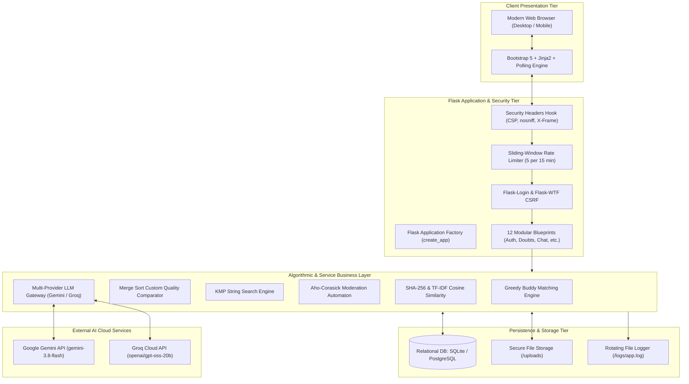
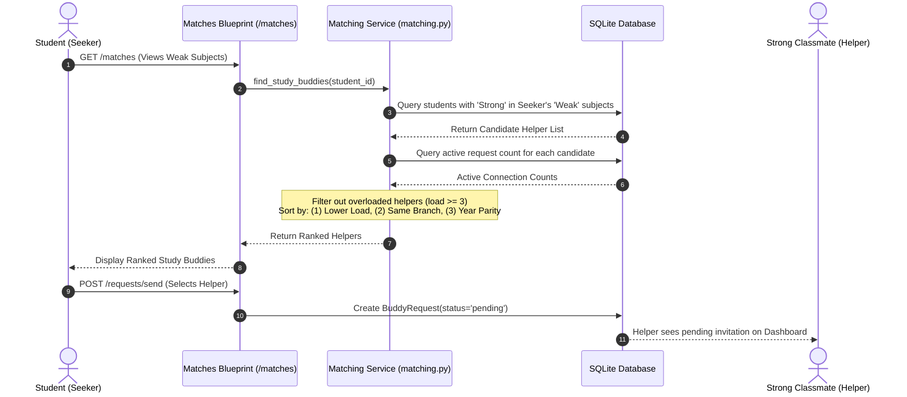
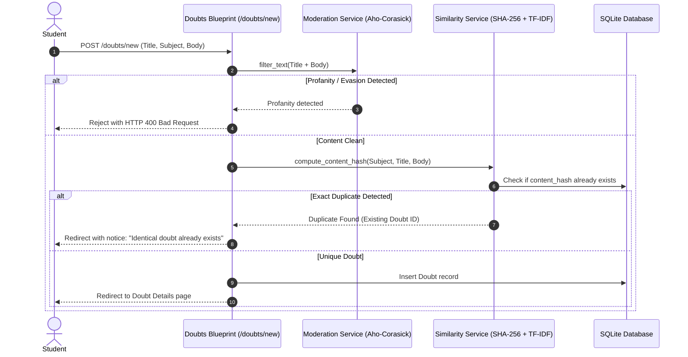
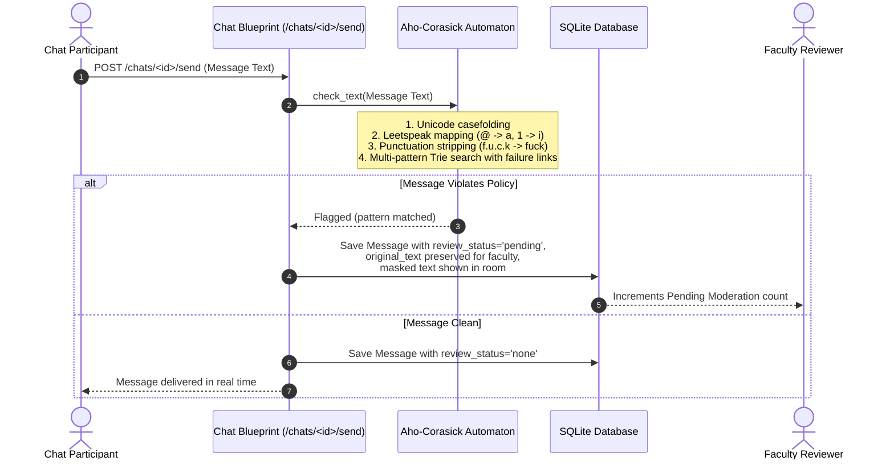

# System Architecture & Flow Diagrams

This document illustrates the tiered architectural design and request data flows of the **AI-Powered Collaborative Learning and Doubt Resolution Platform**.

---

## 1. High-Level Tiered System Architecture

---

## 2. Sequence Diagram: Algorithmic Buddy Matching

---

## 3. Sequence Diagram: Doubt Posting & Duplicate Prevention

---

## 4. Sequence Diagram: Aho-Corasick Message Moderation

