# Database Schema & Entity-Relationship (ER) Model

This document outlines the relational database architecture for the **AI-Powered Collaborative Learning and Doubt Resolution Platform**.

---

## Complete Mermaid Entity-Relationship Diagram

```mermaid
erDiagram
    USERS ||--o{ SKILLS : "configures"
    USERS ||--o{ BUDDY_REQUESTS : "sends / receives"
    USERS ||--o{ CHAT_MEMBERS : "participates_in"
    USERS ||--o{ MESSAGES : "authors"
    USERS ||--o{ GROUP_INVITES : "invites / invited_to"
    USERS ||--o{ MESSAGE_REPORTS : "submits"
    USERS ||--o{ DOUBTS : "asks"
    USERS ||--o{ ANSWERS : "provides"
    USERS ||--o{ ANSWER_VOTES : "casts"
    USERS ||--o{ REPUTATIONS : "earns"
    USERS ||--o{ QUIZ_ATTEMPTS : "takes"
    USERS ||--o{ LEARNING_PATHS : "receives"
    USERS ||--o{ MODERATION_LOGS : "triggers"

    CHAT_ROOMS ||--o{ CHAT_MEMBERS : "contains"
    CHAT_ROOMS ||--o{ MESSAGES : "houses"
    CHAT_ROOMS ||--o{ GROUP_INVITES : "associated_with"

    DOUBTS ||--o{ ANSWERS : "receives"
    DOUBTS ||--o{ AI_HINTS : "generates"
    ANSWERS ||--o{ ANSWER_VOTES : "voted_by"

    USERS {
        int id PK
        string name
        string email UK
        string password_hash
        string role "student | teacher"
        string branch
        int year
        int moderation_strikes
        datetime created_at
    }

    SKILLS {
        int id PK
        int user_id FK
        string subject
        string level "Weak | Average | Strong"
        datetime updated_at
    }

    BUDDY_REQUESTS {
        int id PK
        int sender_id FK
        int receiver_id FK
        string subject
        string status "pending | accepted | rejected"
        datetime created_at
    }

    CHAT_ROOMS {
        int id PK
        string type "private | group"
        string name
        string subject
        int created_by_id FK
        boolean is_active
        datetime created_at
    }

    CHAT_MEMBERS {
        int id PK
        int room_id FK
        int user_id FK
        string role "admin | member"
        datetime joined_at
    }

    MESSAGES {
        int id PK
        int room_id FK
        int sender_id FK
        text body
        string image_path
        boolean is_system
        text original_text
        string flag_reason
        string review_status "none | pending | dismissed | confirmed"
        int reviewed_by FK
        datetime reviewed_at
        datetime created_at
    }

    GROUP_INVITES {
        int id PK
        int room_id FK
        int invited_user_id FK
        int invited_by_id FK
        string status "pending | accepted | declined | cancelled"
        datetime created_at
    }

    MESSAGE_REPORTS {
        int id PK
        int message_id FK
        int reporter_id FK
        string reason "abusive | harassment | spam | inappropriate | other"
        string note
        datetime created_at
    }

    DOUBTS {
        int id PK
        int user_id FK
        string subject
        string title
        text body
        string image_path
        boolean is_anonymous
        string status "open | solved | closed"
        int solved_answer_id FK
        boolean needs_human
        string content_hash
        datetime created_at
    }

    ANSWERS {
        int id PK
        int doubt_id FK
        int user_id FK
        text body
        string image_path
        int upvotes
        boolean is_verified
        int verified_by FK
        datetime verified_at
        datetime created_at
    }

    ANSWER_VOTES {
        int id PK
        int answer_id FK
        int user_id FK
        datetime created_at
    }

    REPUTATIONS {
        int id PK
        int user_id FK
        string subject
        int score
        string badge "Helper | Expert | Guru"
        datetime updated_at
    }

    AI_HINTS {
        int id PK
        int doubt_id FK
        int user_id FK
        text hint_text
        int generation_count
        boolean helpful
        datetime created_at
    }

    QUIZ_ATTEMPTS {
        int id PK
        int user_id FK
        string subject
        string topic
        int total_questions
        int score
        text answers_payload
        boolean is_completed
        datetime created_at
    }

    LEARNING_PATHS {
        int id PK
        int user_id FK
        string profile_hash
        text roadmap_json
        datetime created_at
    }

    MODERATION_LOGS {
        int id PK
        int user_id FK
        string source "chat | doubt | answer"
        string action "flagged | blocked"
        int matched_count
        datetime created_at
    }
```

---

## Key Constraints & Indexes

1. **Unique Constraints:**
   - `users.email` (Unique login identifier)
   - `skills(user_id, subject)` (One skill level entry per student per subject)
   - `reputations(user_id, subject)` (Unique reputation tracker per student per subject)
   - `group_invites(room_id, invited_user_id)` where `status='pending'` (Prevents spam invites)
   - `message_reports(message_id, reporter_id)` (One report per student per message)
   - `answer_votes(answer_id, user_id)` (Single vote per answer per student)

2. **Performance Indexes:**
   - `doubts(subject, created_at)`: Accelerates subject-filtered feeds and Exam Mode aggregations.
   - `messages(room_id, id)`: Enables sub-millisecond polling queries (`WHERE room_id = X AND id > Y`).
   - `doubts(content_hash)`: Instant $O(1)$ duplicate doubt detection.
